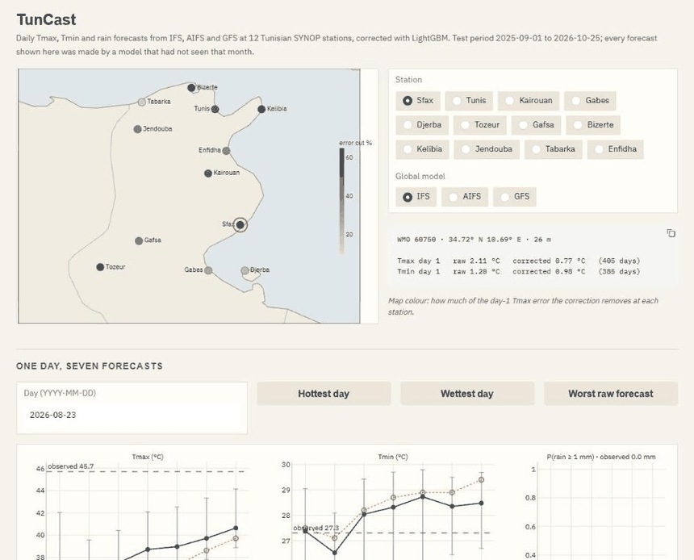

<div dir="rtl">

# TunCast

[English](README.md) · **العربية**

لماذا تخطئ توقعات الطقس في تونس أحيانًا ببضع درجات، وهل يمكن تصحيحها لمكان محدد؟
يأخذ TunCast التوقعات اليومية لثلاثة نماذج عالمية (IFS من ECMWF، ونموذج الذكاء الاصطناعي AIFS
من ECMWF، وGFS من NOAA) لـ 12 محطة أرصاد تونسية، ويقارنها بما قاسته المحطات فعلًا، ثم يتعلم كيف
يصححها. الحرارة القصوى والدنيا والأمطار، من يوم إلى 7 أيام مسبقًا.

</div>



<div dir="rtl">

الورقة: [`paper/main.pdf`](paper/main.pdf) · كل الجداول: [`results/results.md`](results/results.md) ·
فيديو: [`docs/app.mp4`](docs/app.mp4)

## النتائج

فترة الاختبار من 2025-09-01 إلى 2026-10-25، على 12 محطة. كل توقع هنا صدر عن نموذج لم يرَ بيانات ذلك الشهر.

| خطأ الحرارة القصوى لليوم التالي (°م) | قبل التصحيح | بعد التصحيح |
|---|---|---|
| IFS  | 1.74 | 0.89 |
| AIFS | 1.80 | 0.90 |
| GFS  | 1.53 | 0.93 |

- معظم التحسن يأتي من إزالة انحياز ثابت. تصحيح بسيط بمتوسط خطأ آخر 30 يومًا يحقق أغلب الفائدة،
  ويضيف LightGBM فوقه 2-4% لـ IFS وGFS، ولا شيء يُذكر لـ AIFS.
- بعد التصحيح، AIFS هو الأدق بين النماذج الثلاثة.
- توقع المطر الخام (نعم/لا) أسوأ من المعدل المناخي. الاحتمالات المعايرة تصل إلى Brier skill score بحوالي 0.2.
- الأرقام القياسية والأمطار الغزيرة ما زالت صعبة: في 23 أوت 2026 بلغت صفاقس 45.7 °م، بينما قال التوقع المصحح لليوم السابق 40.6.

## البدء السريع

</div>

```bash
uv venv .venv --python 3.11
uv pip install -r requirements.txt --python .venv/Scripts/python.exe
.venv/Scripts/activate        # Linux/macOS: source .venv/bin/activate

python tuncast.py run         # تنزيل البيانات وتشغيل المراحل 1-7 (حوالي ساعة في المرة الأولى)
python tuncast.py app         # فتح التطبيق على http://127.0.0.1:7860
```

<div dir="rtl">

أوامر أخرى:

</div>

```bash
python tuncast.py stations --model AIFS     # المحطات الأكثر استفادة، في الطرفية
python tuncast.py day Sfax 2026-08-23       # التوقعات السبعة ليوم واحد
python tuncast.py run --from 4              # إعادة التشغيل من المرحلة 4
python tuncast.py test                      # الاختبارات، ومنها فحص تسرب البيانات
python tuncast.py paper                     # إعادة بناء paper/main.pdf (يتطلب pdflatex)
```

<div dir="rtl">

التنزيلات محفوظة في `data/raw/`. إذا أوقفك حد الاستخدام في Open-Meteo أو Ogimet، أعد تشغيل نفس الأمر
لاحقًا وسيكمل من حيث توقف.

## التطبيق

صفحة واحدة تحتوي على:

- خريطة للمحطات، ملونة حسب نسبة الخطأ التي يزيلها التصحيح؛
- **يوم واحد، سبعة توقعات**: لأي يوم، التوقعات الصادرة قبله بـ 7 أيام حتى يوم واحد، الخام والمصححة، مقابل ما تم قياسه؛
- الخطأ حسب مدة التوقع في المحطة المختارة، مقارنة بطرق بسيطة؛
- أشرطة تمرير لتغيير التوقع ومشاهدة كيف يتغير التصحيح وتفسيره بـ SHAP؛
- رسم زمني يوضح ساعات UTC التي تكوّن كل قيمة يومية وما هو معروف لحظة إصدار التوقع.

## طريقة العمل

1. **القيم الحقيقية** من تقارير SYNOP التابعة للمنظمة العالمية للأرصاد الجوية (NOAA Global-Hourly، ثم رسائل Ogimet الخام التي نفك ترميزها هنا).
   لم نستعمل Meteostat لأن أمطاره في تونس توقعات وليست قياسات.
2. **التوقعات** من أرشيف Open-Meteo للتشغيلات السابقة. لكل مدة L، كل ساعة مأخوذة من التشغيل الذي كان متاحًا في نهاية اليوم D − L.
3. **التصحيح**: LightGBM كمّي على خطأ التوقع مع مجالات conformal؛ وللمطر احتمال معاير ليوم ممطر ثم الكمية.
4. **الاختبار**: إعادة التدريب كل شهر على بيانات تنتهي قبل بداية الشهر بـ 8 أيام، والمقارنة مع طرق بسيطة على نفس الأيام،
   ومجالات ثقة بإعادة أخذ عينات من أسابيع كاملة.

## البيانات

Open-Meteo (CC BY 4.0)، NOAA NCEI Global-Hourly، رسائل SYNOP عبر Ogimet، ومؤشر NAO من NOAA CPC.

</div>
