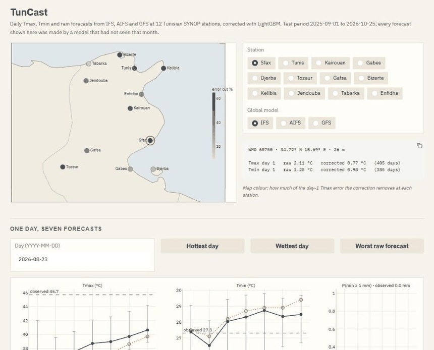

# TunCast

**English** · [العربية](README.ar.md)

Why is the forecast so often a few degrees off in Tunisia, and can it be fixed for one place?
TunCast takes the daily forecasts of three global models (ECMWF IFS, ECMWF's machine-learned
AIFS and NOAA's GFS) for 12 Tunisian weather stations, compares them with what the stations
measured, and learns to correct them. Max and min temperature and rain, 1 to 7 days ahead.



Write-up: [`paper/main.pdf`](paper/main.pdf) · All tables: [`results/results.md`](results/results.md) ·
Video: [`docs/app.mp4`](docs/app.mp4)

## What came out

Test period 2025-09-01 to 2026-10-25, 12 stations. Every forecast here was made by a model that
had not seen that month.

| next-day Tmax error (°C) | raw | corrected |
|---|---|---|
| IFS  | 1.74 | 0.89 |
| AIFS | 1.80 | 0.90 |
| GFS  | 1.53 | 0.93 |

- Most of the gain is removing a steady bias. A 30-day running bias correction gets most of the
  way; LightGBM adds 2-4% on top for IFS and GFS, and nothing significant for AIFS.
- After correction AIFS has the lowest error of the three.
- Used as a yes/no forecast, raw rain is worse than climatology. Calibrated probabilities reach a
  Brier skill score of about 0.2.
- Records and heavy rain are still hard. On 23 August 2026 Sfax reached 45.7 °C; the corrected
  1-day forecast said 40.6.

## Quick start

```bash
uv venv .venv --python 3.11
uv pip install -r requirements.txt --python .venv/Scripts/python.exe
.venv/Scripts/activate        # on Linux/macOS: source .venv/bin/activate

python tuncast.py run         # download data and run steps 1-7 (about 1 h the first time)
python tuncast.py app         # open the app on http://127.0.0.1:7860
```

Everything else:

```bash
python tuncast.py stations --model AIFS     # which stations gain most, in the terminal
python tuncast.py day Sfax 2026-08-23       # the seven forecasts for one day
python tuncast.py run --from 4              # rerun from step 4 (data already downloaded)
python tuncast.py test                      # tests, including the data-leakage check
python tuncast.py paper                     # rebuild paper/main.pdf (needs pdflatex)
```

```
$ python tuncast.py day Sfax 2026-08-23

Sfax, 2026-08-23, IFS

Tmax  observed 45.7 °C
  issued          raw  fixed      80% range
  7 days before   34.0   37.2      34.1-42.0
  4 days before   37.1   38.7      36.3-42.1
  1 day  before   39.7   40.6      38.9-44.1
```

Downloads are cached in `data/raw/`. If Open-Meteo or Ogimet rate-limits you, run the same command
later and it continues where it stopped (Open-Meteo's free tier allows about 10k calls a day).

## The app

One page:

- a map of the stations, coloured by how much of the next-day error the correction removes;
- **one day, seven forecasts**: for any day, the forecasts issued 7 to 1 days before, raw and
  corrected, against what was measured (forecasters call this a dProg/dt chart);
- error by lead time at the chosen station, against simple baselines;
- sliders to change a forecast and watch the correction and its SHAP explanation respond;
- a timing figure: which UTC hours make up each daily value and what is known when a forecast is issued.

## How it works

1. **Truth** comes from WMO SYNOP reports (NOAA Global-Hourly, then raw messages from Ogimet decoded
   here). Meteostat was not used: its Tunisian rain is a forecast, not a measurement.
2. **Forecasts** come from the Open-Meteo archive of past runs. For lead L, every hour is taken from
   the run that existed at the end of day D − L, over the same UTC windows as the station values.
3. **Correction**: quantile LightGBM on the forecast error, with conformal intervals; for rain, a
   calibrated wet-day probability and a wet-day amount.
4. **Testing**: retrain every month on data that ends 8 days before the month starts; compare with
   raw, climatology, persistence, 30-day bias correction and linear MOS on the same rows;
   confidence intervals from resampling whole weeks.

```
pipeline/step1_observations.py   SYNOP -> daily Tmax, Tmin, rain
pipeline/step2_forecasts.py      archived IFS / AIFS / GFS forecasts
pipeline/step3_quality_control.py
pipeline/step4_features.py       inputs known at issue time only
pipeline/step5_train_evaluate.py monthly walk-forward
pipeline/step6_report.py         tables and figures
pipeline/step7_explain.py        SHAP
pipeline/step8_gru_optional.py   GRU vs LightGBM
pipeline/step9_drought_optional.py  SPI-3 outlook
app.py · tuncast.py · paper/ · tests/
```

## Data

Open-Meteo (CC BY 4.0), NOAA NCEI Global-Hourly, SYNOP messages via Ogimet, NAO index from NOAA CPC.
