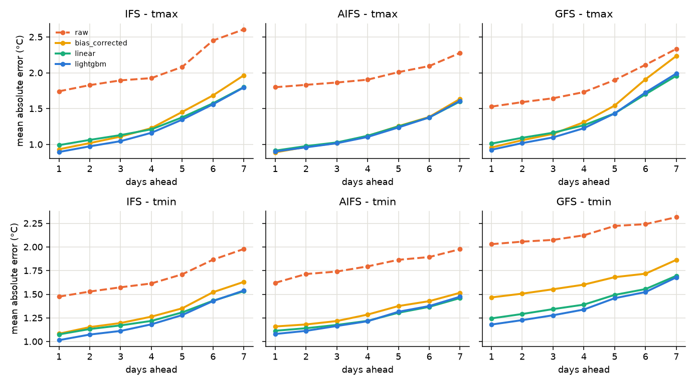
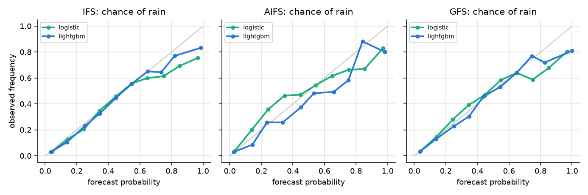

# Results

Test period 2025-09-01 to 2026-10-25. Stations: Sfax, Tunis, Kairouan, Gabes, Djerba, Tozeur, Gafsa, Bizerte, Kelibia, Jendouba, Tabarka, Enfidha.

## LightGBM vs raw, all stations

improvement % = relative drop in MAE; 95% CI from a weekly block bootstrap.

| model   | target   |   lead |   days |   MAE raw |   MAE lightgbm |   improvement % |   95% CI low % |   95% CI high % |
|:--------|:---------|-------:|-------:|----------:|---------------:|----------------:|---------------:|----------------:|
| AIFS    | tmax     |      1 |   4703 |      1.80 |           0.90 |           49.87 |          46.78 |           53.10 |
| AIFS    | tmax     |      2 |   4693 |      1.83 |           0.96 |           47.61 |          44.07 |           51.11 |
| AIFS    | tmax     |      3 |   4680 |      1.86 |           1.02 |           45.45 |          41.73 |           49.19 |
| AIFS    | tmax     |      4 |   4519 |      1.90 |           1.10 |           41.99 |          38.13 |           45.74 |
| AIFS    | tmax     |      5 |   4520 |      2.01 |           1.24 |           38.43 |          33.93 |           42.27 |
| AIFS    | tmax     |      6 |   4682 |      2.09 |           1.38 |           34.25 |          30.18 |           38.31 |
| AIFS    | tmax     |      7 |   4520 |      2.28 |           1.61 |           29.33 |          24.43 |           33.97 |
| AIFS    | tmin     |      1 |   4353 |      1.62 |           1.08 |           33.37 |          27.94 |           38.60 |
| AIFS    | tmin     |      2 |   4375 |      1.71 |           1.11 |           35.05 |          29.57 |           40.34 |
| AIFS    | tmin     |      3 |   4355 |      1.74 |           1.16 |           33.09 |          27.54 |           38.65 |
| AIFS    | tmin     |      4 |   4224 |      1.79 |           1.22 |           32.30 |          26.74 |           38.29 |
| AIFS    | tmin     |      5 |   4202 |      1.86 |           1.32 |           29.45 |          24.24 |           35.21 |
| AIFS    | tmin     |      6 |   4206 |      1.89 |           1.38 |           27.36 |          22.18 |           32.91 |
| AIFS    | tmin     |      7 |   4200 |      1.98 |           1.47 |           25.41 |          20.58 |           30.65 |
| GFS     | tmax     |      1 |   4703 |      1.53 |           0.93 |           39.42 |          35.17 |           43.27 |
| GFS     | tmax     |      2 |   4693 |      1.59 |           1.02 |           35.93 |          31.86 |           39.64 |
| GFS     | tmax     |      3 |   4680 |      1.64 |           1.10 |           33.22 |          29.28 |           37.10 |
| GFS     | tmax     |      4 |   4679 |      1.73 |           1.23 |           29.15 |          25.44 |           32.81 |
| GFS     | tmax     |      5 |   4680 |      1.90 |           1.43 |           24.54 |          21.18 |           28.17 |
| GFS     | tmax     |      6 |   4682 |      2.11 |           1.73 |           18.27 |          14.08 |           22.47 |
| GFS     | tmax     |      7 |   4680 |      2.33 |           1.99 |           14.73 |          10.73 |           18.46 |
| GFS     | tmin     |      1 |   4353 |      2.03 |           1.18 |           41.87 |          34.97 |           47.92 |
| GFS     | tmin     |      2 |   4375 |      2.06 |           1.23 |           40.35 |          33.86 |           46.29 |
| GFS     | tmin     |      3 |   4355 |      2.07 |           1.28 |           38.40 |          32.25 |           44.13 |
| GFS     | tmin     |      4 |   4359 |      2.12 |           1.34 |           36.95 |          30.71 |           42.46 |
| GFS     | tmin     |      5 |   4344 |      2.22 |           1.46 |           34.38 |          27.99 |           40.04 |
| GFS     | tmin     |      6 |   4352 |      2.24 |           1.52 |           32.03 |          25.94 |           37.70 |
| GFS     | tmin     |      7 |   4336 |      2.32 |           1.68 |           27.49 |          22.01 |           32.73 |
| IFS     | tmax     |      1 |   4703 |      1.74 |           0.89 |           48.63 |          44.87 |           52.32 |
| IFS     | tmax     |      2 |   4693 |      1.83 |           0.97 |           46.72 |          43.01 |           50.27 |
| IFS     | tmax     |      3 |   4680 |      1.89 |           1.05 |           44.79 |          41.01 |           48.46 |
| IFS     | tmax     |      4 |   4679 |      1.93 |           1.16 |           39.63 |          35.55 |           43.40 |
| IFS     | tmax     |      5 |   4680 |      2.08 |           1.35 |           35.34 |          31.56 |           38.97 |
| IFS     | tmax     |      6 |   4682 |      2.45 |           1.56 |           36.33 |          32.16 |           40.45 |
| IFS     | tmax     |      7 |   4680 |      2.61 |           1.80 |           31.09 |          26.96 |           35.15 |
| IFS     | tmin     |      1 |   4353 |      1.48 |           1.02 |           31.19 |          27.76 |           34.92 |
| IFS     | tmin     |      2 |   4375 |      1.53 |           1.07 |           29.74 |          26.54 |           33.15 |
| IFS     | tmin     |      3 |   4355 |      1.57 |           1.11 |           29.32 |          26.38 |           32.26 |
| IFS     | tmin     |      4 |   4359 |      1.61 |           1.18 |           26.77 |          23.69 |           29.91 |
| IFS     | tmin     |      5 |   4344 |      1.71 |           1.28 |           25.19 |          22.32 |           28.12 |
| IFS     | tmin     |      6 |   4352 |      1.87 |           1.43 |           23.44 |          20.17 |           26.95 |
| IFS     | tmin     |      7 |   4336 |      1.98 |           1.54 |           22.19 |          19.30 |           25.25 |

## LightGBM vs raw, Sfax

| model   | target   |   lead |   days |   MAE raw |   MAE lightgbm |   improvement % |   95% CI low % |   95% CI high % |
|:--------|:---------|-------:|-------:|----------:|---------------:|----------------:|---------------:|----------------:|
| AIFS    | tmax     |      1 |    392 |      2.23 |           0.83 |           62.76 |          58.21 |           68.03 |
| AIFS    | tmax     |      2 |    390 |      2.18 |           0.87 |           60.10 |          54.86 |           65.28 |
| AIFS    | tmax     |      3 |    389 |      2.18 |           0.93 |           57.51 |          52.00 |           63.74 |
| AIFS    | tmax     |      4 |    376 |      2.13 |           1.04 |           51.27 |          44.84 |           58.22 |
| AIFS    | tmax     |      5 |    376 |      2.17 |           1.16 |           46.60 |          39.95 |           54.16 |
| AIFS    | tmax     |      6 |    389 |      2.21 |           1.24 |           43.72 |          36.42 |           51.77 |
| AIFS    | tmax     |      7 |    375 |      2.31 |           1.48 |           35.94 |          27.71 |           44.19 |
| AIFS    | tmin     |      1 |    355 |      1.68 |           0.95 |           43.70 |          34.87 |           52.55 |
| AIFS    | tmin     |      2 |    360 |      1.78 |           1.04 |           41.42 |          31.43 |           50.75 |
| AIFS    | tmin     |      3 |    358 |      1.80 |           1.13 |           37.49 |          28.23 |           46.67 |
| AIFS    | tmin     |      4 |    343 |      1.84 |           1.16 |           36.89 |          26.48 |           46.62 |
| AIFS    | tmin     |      5 |    348 |      1.91 |           1.27 |           33.45 |          25.22 |           42.20 |
| AIFS    | tmin     |      6 |    342 |      1.90 |           1.29 |           32.18 |          23.04 |           41.67 |
| AIFS    | tmin     |      7 |    346 |      2.00 |           1.37 |           31.69 |          21.77 |           41.01 |
| GFS     | tmax     |      1 |    392 |      1.08 |           0.79 |           26.87 |          16.88 |           36.77 |
| GFS     | tmax     |      2 |    390 |      1.18 |           0.91 |           22.91 |          13.55 |           32.46 |
| GFS     | tmax     |      3 |    389 |      1.29 |           1.01 |           21.79 |          12.64 |           30.60 |
| GFS     | tmax     |      4 |    390 |      1.39 |           1.11 |           19.70 |          11.46 |           28.22 |
| GFS     | tmax     |      5 |    390 |      1.50 |           1.23 |           18.50 |          11.29 |           25.44 |
| GFS     | tmax     |      6 |    389 |      1.77 |           1.52 |           14.52 |           7.95 |           21.45 |
| GFS     | tmax     |      7 |    389 |      1.89 |           1.66 |           12.27 |           6.19 |           18.69 |
| GFS     | tmin     |      1 |    355 |      1.74 |           1.07 |           38.52 |          28.22 |           49.61 |
| GFS     | tmin     |      2 |    360 |      1.70 |           1.10 |           35.26 |          25.77 |           45.87 |
| GFS     | tmin     |      3 |    358 |      1.75 |           1.18 |           32.80 |          23.43 |           42.90 |
| GFS     | tmin     |      4 |    355 |      1.80 |           1.30 |           27.51 |          18.21 |           36.55 |
| GFS     | tmin     |      5 |    361 |      1.91 |           1.37 |           27.88 |          19.22 |           35.88 |
| GFS     | tmin     |      6 |    355 |      1.90 |           1.44 |           24.35 |          16.89 |           31.81 |
| GFS     | tmin     |      7 |    358 |      2.01 |           1.61 |           20.11 |          12.42 |           27.33 |
| IFS     | tmax     |      1 |    392 |      2.10 |           0.77 |           63.14 |          56.39 |           69.21 |
| IFS     | tmax     |      2 |    390 |      2.23 |           0.84 |           62.26 |          55.85 |           68.46 |
| IFS     | tmax     |      3 |    389 |      2.32 |           0.91 |           60.70 |          54.57 |           66.54 |
| IFS     | tmax     |      4 |    390 |      2.34 |           1.04 |           55.63 |          48.96 |           62.17 |
| IFS     | tmax     |      5 |    390 |      2.32 |           1.08 |           53.61 |          46.51 |           60.90 |
| IFS     | tmax     |      6 |    389 |      2.65 |           1.38 |           47.77 |          39.90 |           55.14 |
| IFS     | tmax     |      7 |    389 |      2.74 |           1.56 |           43.27 |          35.83 |           50.62 |
| IFS     | tmin     |      1 |    355 |      1.20 |           0.97 |           19.04 |          12.07 |           26.12 |
| IFS     | tmin     |      2 |    360 |      1.21 |           1.05 |           12.95 |           5.80 |           20.16 |
| IFS     | tmin     |      3 |    358 |      1.23 |           1.11 |           10.06 |           4.06 |           16.46 |
| IFS     | tmin     |      4 |    355 |      1.27 |           1.14 |           10.39 |           4.56 |           15.97 |
| IFS     | tmin     |      5 |    361 |      1.38 |           1.30 |            5.11 |           1.55 |            9.20 |
| IFS     | tmin     |      6 |    355 |      1.55 |           1.39 |           10.24 |           4.08 |           16.81 |
| IFS     | tmin     |      7 |    358 |      1.57 |           1.47 |            6.53 |           0.55 |           12.31 |

## MAE of all temperature methods (°C)

| model   | target   |   lead |   raw |   climatology |   persistence |   bias_corrected |   linear |   lightgbm |
|:--------|:---------|-------:|------:|--------------:|--------------:|-----------------:|---------:|-----------:|
| AIFS    | tmax     |      1 |  1.80 |          2.42 |          1.97 |             0.89 |     0.91 |       0.90 |
| AIFS    | tmax     |      2 |  1.83 |          2.42 |          2.61 |             0.96 |     0.98 |       0.96 |
| AIFS    | tmax     |      3 |  1.86 |          2.42 |          2.87 |             1.02 |     1.03 |       1.02 |
| AIFS    | tmax     |      4 |  1.90 |          2.42 |          2.95 |             1.12 |     1.12 |       1.10 |
| AIFS    | tmax     |      5 |  2.01 |          2.43 |          3.02 |             1.26 |     1.25 |       1.24 |
| AIFS    | tmax     |      6 |  2.09 |          2.42 |          3.15 |             1.38 |     1.38 |       1.38 |
| AIFS    | tmax     |      7 |  2.28 |          2.42 |          3.18 |             1.64 |     1.60 |       1.61 |
| AIFS    | tmin     |      1 |  1.62 |          2.12 |          1.82 |             1.16 |     1.11 |       1.08 |
| AIFS    | tmin     |      2 |  1.71 |          2.11 |          2.22 |             1.18 |     1.14 |       1.11 |
| AIFS    | tmin     |      3 |  1.74 |          2.11 |          2.42 |             1.22 |     1.18 |       1.16 |
| AIFS    | tmin     |      4 |  1.79 |          2.13 |          2.50 |             1.29 |     1.22 |       1.22 |
| AIFS    | tmin     |      5 |  1.86 |          2.14 |          2.63 |             1.38 |     1.30 |       1.32 |
| AIFS    | tmin     |      6 |  1.89 |          2.12 |          2.69 |             1.43 |     1.37 |       1.38 |
| AIFS    | tmin     |      7 |  1.98 |          2.13 |          2.75 |             1.52 |     1.46 |       1.47 |
| GFS     | tmax     |      1 |  1.53 |          2.42 |          1.97 |             0.96 |     1.01 |       0.93 |
| GFS     | tmax     |      2 |  1.59 |          2.42 |          2.61 |             1.06 |     1.09 |       1.02 |
| GFS     | tmax     |      3 |  1.64 |          2.42 |          2.87 |             1.15 |     1.16 |       1.10 |
| GFS     | tmax     |      4 |  1.73 |          2.42 |          3.00 |             1.31 |     1.27 |       1.23 |
| GFS     | tmax     |      5 |  1.90 |          2.43 |          3.07 |             1.54 |     1.43 |       1.43 |
| GFS     | tmax     |      6 |  2.11 |          2.42 |          3.15 |             1.91 |     1.70 |       1.73 |
| GFS     | tmax     |      7 |  2.33 |          2.42 |          3.21 |             2.23 |     1.96 |       1.99 |
| GFS     | tmin     |      1 |  2.03 |          2.12 |          1.82 |             1.47 |     1.25 |       1.18 |
| GFS     | tmin     |      2 |  2.06 |          2.11 |          2.22 |             1.51 |     1.29 |       1.23 |
| GFS     | tmin     |      3 |  2.07 |          2.11 |          2.42 |             1.55 |     1.34 |       1.28 |
| GFS     | tmin     |      4 |  2.12 |          2.11 |          2.50 |             1.60 |     1.39 |       1.34 |
| GFS     | tmin     |      5 |  2.22 |          2.12 |          2.64 |             1.68 |     1.49 |       1.46 |
| GFS     | tmin     |      6 |  2.24 |          2.11 |          2.69 |             1.72 |     1.55 |       1.52 |
| GFS     | tmin     |      7 |  2.32 |          2.12 |          2.73 |             1.86 |     1.70 |       1.68 |
| IFS     | tmax     |      1 |  1.74 |          2.42 |          1.97 |             0.93 |     0.99 |       0.89 |
| IFS     | tmax     |      2 |  1.83 |          2.42 |          2.61 |             1.02 |     1.06 |       0.97 |
| IFS     | tmax     |      3 |  1.89 |          2.42 |          2.87 |             1.11 |     1.13 |       1.05 |
| IFS     | tmax     |      4 |  1.93 |          2.42 |          3.00 |             1.23 |     1.21 |       1.16 |
| IFS     | tmax     |      5 |  2.08 |          2.43 |          3.07 |             1.45 |     1.38 |       1.35 |
| IFS     | tmax     |      6 |  2.45 |          2.42 |          3.15 |             1.68 |     1.57 |       1.56 |
| IFS     | tmax     |      7 |  2.61 |          2.42 |          3.21 |             1.96 |     1.80 |       1.80 |
| IFS     | tmin     |      1 |  1.48 |          2.12 |          1.82 |             1.08 |     1.08 |       1.02 |
| IFS     | tmin     |      2 |  1.53 |          2.11 |          2.22 |             1.15 |     1.13 |       1.07 |
| IFS     | tmin     |      3 |  1.57 |          2.11 |          2.42 |             1.20 |     1.17 |       1.11 |
| IFS     | tmin     |      4 |  1.61 |          2.11 |          2.50 |             1.26 |     1.22 |       1.18 |
| IFS     | tmin     |      5 |  1.71 |          2.12 |          2.64 |             1.35 |     1.31 |       1.28 |
| IFS     | tmin     |      6 |  1.87 |          2.11 |          2.69 |             1.52 |     1.43 |       1.43 |
| IFS     | tmin     |      7 |  1.98 |          2.12 |          2.73 |             1.63 |     1.53 |       1.54 |

## 80% intervals

| model   | target   |   lightgbm coverage % |   lightgbm width |   conformal coverage % |   conformal width |
|:--------|:---------|----------------------:|-----------------:|-----------------------:|------------------:|
| AIFS    | tmax     |                 73.36 |             3.25 |                  81.39 |              3.89 |
| AIFS    | tmin     |                 69.26 |             3.25 |                  83.48 |              4.34 |
| GFS     | tmax     |                 75.90 |             3.83 |                  81.20 |              4.35 |
| GFS     | tmin     |                 73.38 |             3.89 |                  80.26 |              4.49 |
| IFS     | tmax     |                 77.54 |             3.80 |                  81.31 |              4.13 |
| IFS     | tmin     |                 76.18 |             3.66 |                  80.15 |              4.00 |

## Rain

| model   | method      |   days |   rain days |   Brier |   Brier skill vs climatology |   ROC AUC |   PR AUC |   MAE on rain days (mm) |   heavy days |   heavy found % |   false alarms % |
|:--------|:------------|-------:|------------:|--------:|-----------------------------:|----------:|---------:|------------------------:|-------------:|----------------:|-----------------:|
| AIFS    | climatology |  27223 |        3646 |    0.10 |                         0.00 |      0.76 |     0.35 |                  nan    |       nan    |          nan    |           nan    |
| AIFS    | raw         |  27223 |        3646 |    0.15 |                        -0.45 |      0.84 |     0.41 |                    5.25 |       822.00 |           36.98 |            54.56 |
| AIFS    | logistic    |  27223 |        3646 |    0.08 |                         0.22 |      0.87 |     0.60 |                  nan    |       nan    |          nan    |           nan    |
| AIFS    | lightgbm    |  27223 |        3646 |    0.08 |                         0.21 |      0.88 |     0.58 |                    5.44 |       822.00 |           46.11 |            72.69 |
| GFS     | climatology |  27654 |        3666 |    0.10 |                         0.00 |      0.76 |     0.35 |                  nan    |       nan    |          nan    |           nan    |
| GFS     | raw         |  27654 |        3666 |    0.13 |                        -0.28 |      0.73 |     0.33 |                    6.26 |       822.00 |           25.79 |            57.60 |
| GFS     | logistic    |  27654 |        3666 |    0.08 |                         0.17 |      0.85 |     0.53 |                  nan    |       nan    |          nan    |           nan    |
| GFS     | lightgbm    |  27654 |        3666 |    0.08 |                         0.19 |      0.86 |     0.53 |                    5.15 |       822.00 |           47.81 |            78.62 |
| IFS     | climatology |  27478 |        3665 |    0.10 |                         0.00 |      0.76 |     0.35 |                  nan    |       nan    |          nan    |           nan    |
| IFS     | raw         |  27478 |        3665 |    0.14 |                        -0.32 |      0.77 |     0.37 |                    6.09 |       822.00 |           29.08 |            65.16 |
| IFS     | logistic    |  27478 |        3665 |    0.08 |                         0.18 |      0.85 |     0.54 |                  nan    |       nan    |          nan    |           nan    |
| IFS     | lightgbm    |  27478 |        3665 |    0.08 |                         0.20 |      0.87 |     0.55 |                    5.25 |       822.00 |           52.68 |            76.23 |

## Tmax by season, leads 1-3

| model   | season   |   MAE raw |   MAE lightgbm |   improvement % |
|:--------|:---------|----------:|---------------:|----------------:|
| AIFS    | autumn   |      1.77 |           0.88 |           50.27 |
| AIFS    | spring   |      1.80 |           1.02 |           43.60 |
| AIFS    | summer   |      2.16 |           1.05 |           51.27 |
| AIFS    | winter   |      1.64 |           0.94 |           42.50 |
| GFS     | autumn   |      1.62 |           0.93 |           42.58 |
| GFS     | spring   |      1.58 |           1.06 |           33.14 |
| GFS     | summer   |      1.71 |           1.13 |           34.09 |
| GFS     | winter   |      1.42 |           1.00 |           29.79 |
| IFS     | autumn   |      1.77 |           0.91 |           48.83 |
| IFS     | spring   |      1.79 |           0.98 |           45.65 |
| IFS     | summer   |      2.00 |           1.06 |           46.85 |
| IFS     | winter   |      1.75 |           0.98 |           43.88 |
